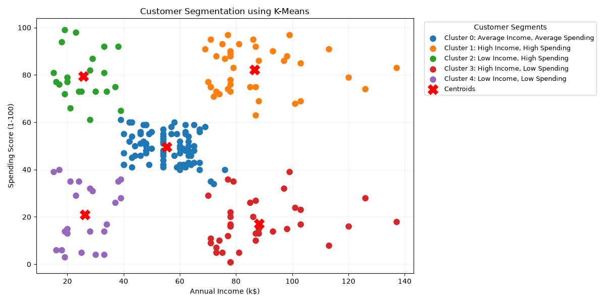

# Customer Segmentation using K-Means Clustering

## Overview
This project uses K-Means clustering to group retail customers based on their annual income and spending scores. The goal is to identify customer segments that can help businesses understand customer behavior and plan targeted marketing strategies.

## Dataset
The Mall Customers dataset contains the following information:
- Customer ID
- Gender
- Age
- Annual Income
- Spending Score

For clustering, this project uses:
- Annual Income (k$)
- Spending Score (1-100)

Customer ID is excluded because it is only an identifier.

## Algorithm
K-Means is an unsupervised machine learning algorithm that groups data points into clusters based on similarity.

The Elbow Method was used to help select the number of clusters. Based on the resulting plot, five clusters were selected.

## Visualization

The scatter plot shows the customer groups identified by K-Means. The X markers represent the cluster centroids.

## Technologies Used
- Python
- Pandas
- Matplotlib
- Scikit-learn

## How to Run

1. Clone or download this repository.
2. Install the required libraries:

   `pip install -r requirements.txt`

3. Run the Python script:

   `python src/customer_segmentation.py`

## Applications
Customer segmentation can help businesses:
- Develop targeted marketing campaigns.
- Identify high-spending customer groups.
- Design personalized offers.
- Understand different customer spending patterns.